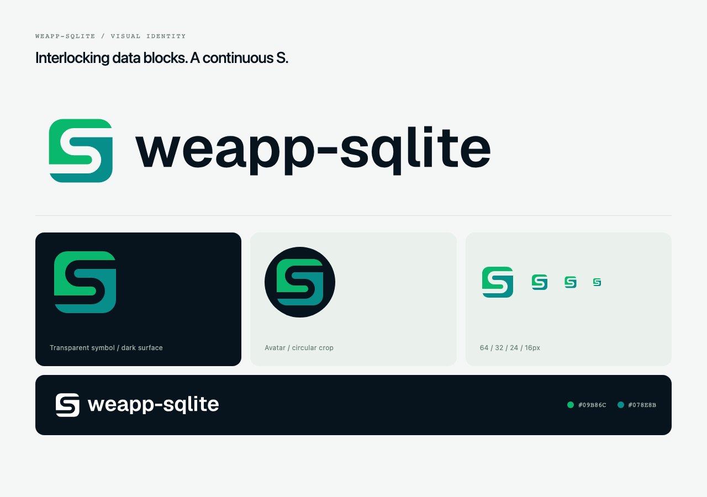
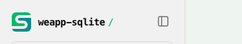
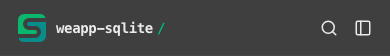

# Logo 重设计验收 · 2026-10-16

本次在 `codex/redesign-sqlite-logo` 分支完成，起点为 `main` 的 `66ceb4530679aa5712edbf6c5dd8f620d7ac7167`。按用户要求，将原窗口与数据库圆柱场景重设计为两片互扣的数据块，中间保留 S 形透明通道。用户已确认采用本版标志。

## 交付

- 统一的彩色图标、512px 头像 SVG/PNG、横版、单色及反白组合标；保留原有文件名。
- 两份可编辑的矢量来源与 `pnpm brand:generate` / `pnpm brand:check`；文档站副本与位图统一生成。
- 字标已转为路径；Geist 来源与 OFL 许可一并记录，浏览器无需加载字体。
- 文档导航使用不裁切的 32px 图标，新增 SVG / 16px / 32px favicon 与 180px Apple touch icon；README 随系统主题切换组合标。
- 根目录新增开发依赖 `sharp`，用于本地素材生成；没有修改运行时包或公共 API。
- 文档站增加包级 lint-staged 配置，使提交检查使用文档站的 ESLint 9，根目录继续使用 ESLint 10。

## 检查结果

| 检查               | 结果                                                                                          |
| ------------------ | --------------------------------------------------------------------------------------------- |
| `pnpm brand:check` | 11 个生成产物与来源一致                                                                       |
| SVG XML 与内容检查 | 9 个文件可解析，无脚本、外链或外部字体；7 个发布 SVG 均包含可访问名称与说明                   |
| 变体轮廓           | 两片图形及旋转变换一致；单色、反白未保留彩色填充                                              |
| PNG                | 512 / 16 / 32 / 180px，RGBA，四角透明                                                         |
| 文档副本           | icon / avatar 与 assets 字节及 SHA256 一致；静态导出包含全部 favicon                          |
| 根 ESLint          | `scripts/brand-assets.ts`、`assets/README.md`、根 README 通过                                 |
| 脚本类型           | `pnpm exec tsc -p tsconfig.acceptance.json` 通过                                              |
| 文档站             | 独立 lint、`types:check`、完整生产构建通过，生成 61 个静态页面                                |
| 后台浏览器         | 桌面 1440px、手机 390px 与窄屏 320px；导航图标为 32 × 32px，无横向溢出，所有 favicon 返回 200 |
| 小尺寸预览         | 64 / 32 / 24 / 16px、浅深背景、单色与圆形头像裁切已审阅                                       |

## weapp.dev 下游同步

同一符号已同步到本地 `weapp.dev` 的 `codex/add-weapp-sqlite-planet` 分支。共享来源、双站 `dist/brands` 和 CLI `dist/lab/logos` 四处的 SHA256 均为 `fa28eedfa015b133b34a9baf47aa0b35c45fa76dc8d13cae76dfe2da8adaf90a`。素材来源由 weapp.dev 的品牌归属文件记录。

同步后重新通过双站完整构建、CLI 构建、CLI 后台浏览器回归，以及 tarball 工作区外安装 smoke。双站桌面、手机、短屏、窄屏与详情页证据已重拍；11 个星球完整、手机图标至少 32px、无横向溢出，8 次详情页 Axe 扫描零违规。

所有浏览器均显式以 `headless: true` 启动，由验证脚本在 `finally` 中关闭 context、browser 与所属 HTTP 服务。没有操作用户 Chrome，也没有保留临时页面。中间过程证据保存在本仓库忽略的 `artifacts/acceptance/branding-20261016/`。
